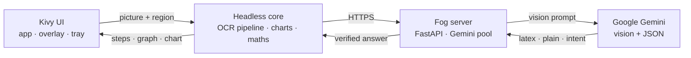

<div align="center">

# Aieva

**Screen-aware AI educational visualisation assistant for interactive smart boards and desktop computers.**

</div>

<div align="center">

[](https://www.python.org/)
[](https://kivy.org/)
[](https://fastapi.tiangolo.com/)
[](https://ai.google.dev/)
[](#testing)
[](LICENSE)

</div>

---

Aieva turns an interactive whiteboard into a teaching assistant. The teacher
selects a region of the board, Aieva **reads the handwriting with Gemini**,
understands what it is (an equation, a graph, a table of numbers, a word
problem), **computes the answer with SymPy**, and draws the solution, the
graph or the chart right on the board — without typing a single character.

| Home | Equation + sliders | 3D surface |
|---|---|---|
|  |  |  |

---

## Table of contents

- [What it does](#what-it-does)
- [Architecture](#architecture)
- [Quick start](#quick-start)
- [Configuration](#configuration)
- [Project layout](#project-layout)
- [Testing](#testing)
- [Documentation](#documentation)
- [Limitations](#limitations)
- [License](#license)

---

## What it does

### Vision — the board is read by Gemini

| | |
|---|---|
| **Board OCR** | The captured region of the board is sent to Gemini with a strict JSON prompt and comes back as structured data: LaTeX, plain text, a confidence note, the kind of content and the **intent**. |
| **Intent routing** | One model, many answers — `explain`, `solve`, `plot`, `integrate`, `chart` and `word problem` are routed to the right engine, so a graph is never handled by the integrator. |
| **Multi-key pool** | Several Gemini keys can live in the `.env`. A key whose quota is exhausted is **skipped immediately** and the next key answers, without waiting and without an error on screen. The fallback stays *inside* Gemini, because the OCR needs a model that can read a picture. |

### Mathematics — every answer is verified, never guessed

| | |
|---|---|
| **SymPy core** | Solving, simplification, derivatives, definite and indefinite integrals, limits, series, linear algebra (matrices, systems, complex numbers) and statistics — all verified symbolically. |
| **2D & 3D graphs** | A real Matplotlib canvas inside Kivy: drag to rotate, pinch to zoom, parameter sliders for 3D surfaces. |
| **Subject-agnostic charts** | Bar, line and pie charts live in `aieva/core/charts.py`. The maths uses them — and so can physics, chemistry and biology. |
| **Word problems** | The text is split into variables, equations and unknowns, then solved with sliders for the unknown parameters. |
| **Documents** | PDF, Word and PowerPoint are read and fed into the same pipeline. |

### Classroom — built for the board

| | |
|---|---|
| **Background service** | Aieva watches the board in the background, shows a compact floating control on the **left edge** of the screen and places the answer where the teacher is looking. |
| **Tray icon** | Start, stop and check the service from the Windows system tray. |
| **Autostart** | Registers itself in the Windows task scheduler: `ONSTART` first, `ONLOGON` without administrator rights, startup folder as the last fallback. |
| **Doctor** | One command checks Python, the packages, the `.env`, the server, the OCR, the capture, the autostart and the service — and says exactly what to fix. |
| **Mock mode** | `AIEVA_MOCK_LLM=true` runs the whole application without a key and without a network — the mode the test suite uses. |

---

## Architecture

Aieva is split into a **headless core** (pure mathematics, no screen), a
**Kivy user interface** and a **fog server** — the only component that ever
talks to Google. This split is what makes the project testable: most of the
code never touches a window.



**The workflow of one reading**

1. The teacher drags the compact control on the left edge of the board and
   selects the region to read (or presses **Scan**).
2. The region is captured and sent to the fog server.
3. The server asks Gemini for structured JSON: LaTeX, plain text, a confidence
   note, the kind of content and the intent.
4. The intent routes the work: SymPy solves and simplifies, Matplotlib draws
   the 2D/3D graph, the chart renderer draws the table, the templates build
   the step-by-step explanation.
5. The result is published to the service and shown in the popup of the
   overlay (or in the full application).

---

## Quick start

### Windows (the target of the project)

```powershell
# 1. install: virtual environment + packages + the .env file
powershell -ExecutionPolicy Bypass -File scripts\setup.ps1

# 2. put the Gemini key into the .env
notepad .env

# 3. start the fog server (leave this window open)
.\scripts\run_server.ps1

# 4. register the automatic start (run PowerShell as administrator)
.\scripts\install_autostart.ps1

# 5. is this PC ready?
.\.venv\Scripts\python.exe -m aieva.core.doctor
```

Then start the application:

```powershell
.\scripts\run_app.ps1                                          # the full application
.\.venv\Scripts\python.exe -m aieva.core.service run --overlay --tray   # background service
```

### Linux / macOS (development)

```bash
python3 -m venv .venv && source .venv/bin/activate
pip install -r requirements.txt -r requirements-server.txt -r requirements-dev.txt
cp .env.example .env                     # put your key into it
AIEVA_MOCK_LLM=true python -m aieva.core.service run          # no key needed
```

### Docker (the fog server only)

```bash
docker build -t aieva-server .
docker run --rm -p 8000:8000 -e GEMINI_API_KEY=... -e AIEVA_SERVER_KEY=... aieva-server
```

---

## Configuration

Everything is read from the environment (the `.env` file). **Never commit a
real key** — `.env` is already in `.gitignore`.

| Variable | Default | Meaning |
|---|---|---|
| `GEMINI_API_KEY` | — | The **first** Gemini key. Required for the server. |
| `GEMINI_API_KEYS` | — | **Extra** Gemini keys, separated by a comma (`key2,key3`). They are used one after the other, and a key that fails is skipped at once. |
| `GEMINI_MODEL` | `gemini-3.8-flash` | The model of the server. |
| `AIEVA_SERVER_URL` | `http://127.0.0.1:8000` | Where the fog server lives. |
| `AIEVA_SERVER_KEY` | — | Protects `/api/*` with the `X-Aieva-Key` header. Set it when the server is not on the same machine. |
| `AIEVA_MOCK_LLM` | `false` | `true` = canned answers, no key and no network needed. |
| `AIEVA_OFFLINE_MODE` | `false` | `true` = the app never calls the cloud. |
| `AIEVA_BOARD_MODE` | `false` | `true` = Aieva *becomes* the board (canvas mode, no screen capture). |
| `AIEVA_CACHE_TTL` | `86400` | How long a cached OCR answer stays valid (seconds). |

---

## Project layout

```
aieva/
  core/               the headless heart — it knows nothing about the screen
    charts.py           the chart renderer (every subject can use it)
    ocr/                the capture of the board, the engines, the pipeline
    service/            the background service, the overlay, the tray, the autostart
    llm/                the client of the fog server and the prompts
    safe_parse.py       the safe reading of a mathematical text
  plugins/
    math/               the mathematics of the subject (solver, graphs, templates)
  ui/
    app.py              the full application
    board_overlay.py    the compact control on the left edge and the popup
    widgets/            the lens, the region selector, the plot canvas, the steps
server/                the fog server in front of Gemini
scripts/               the PowerShell scripts of the school
tests/                 the unit and integration tests
docs/                  the two-page project documentation and the screenshots
shuvojit.md            the full guide (libraries, installation, workflow, limits)
```

---

## Testing

```bash
python -m pytest tests -q      # 748 passed, 3 skipped
python -m ruff check .         # linter — no warning allowed
python -m black --check .      # formatter
python -m aieva.core.doctor    # is this PC ready for the board?
```

The suite is split into **unit tests** (mathematics, charts, parsing,
configuration, the key pool) and **integration tests** (the OCR pipeline, the
server, the Kivy screens, the tray, the Windows scripts). The three skipped
tests need a real Gemini key. GitHub Actions runs the whole suite on Python
3.11 and 3.12 for every push.

---

## Documentation

| Document | What it is |
|---|---|
| [`shuvojit.md`](shuvojit.md) | The full guide: libraries, installation, the workflow of a lesson, the file map, the honest limits. |
| [`docs/Aieva_Project_Documentation.pdf`](docs/Aieva_Project_Documentation.pdf) | The two-page project documentation (submission ready). |
| [`docs/Aieva_Project_Documentation.tex`](docs/Aieva_Project_Documentation.tex) | The LaTeX source of the same document. |

---

## Limitations

- **No offline version.** Gemini reads the board, so a network and a key are
  required. The mock mode is meant for development, not for a lesson.
- **No engine reads every handwriting perfectly.** Glare, an occlusion or an
  unusual notation can be misread — that is why every answer is verified by
  SymPy and the confidence note of Gemini is shown next to it.
- **The Windows parts need a real board PC.** The task of the task scheduler,
  the tray icon, the screen capture, the window placement and the PowerShell
  scripts are written and unit-tested, but the autostart, the tray and the
  capture still have to be tried on the real hardware.
- **The key pool is a fallback, not a load balancer.** The keys are used one
  after the other; parallel requests do not spread over the pool.

---

## License

Released under the [MIT License](LICENSE).

<div align="center">
<sub>Aieva — screen-aware AI educational visualisation assistant (Math edition).</sub>
</div>
