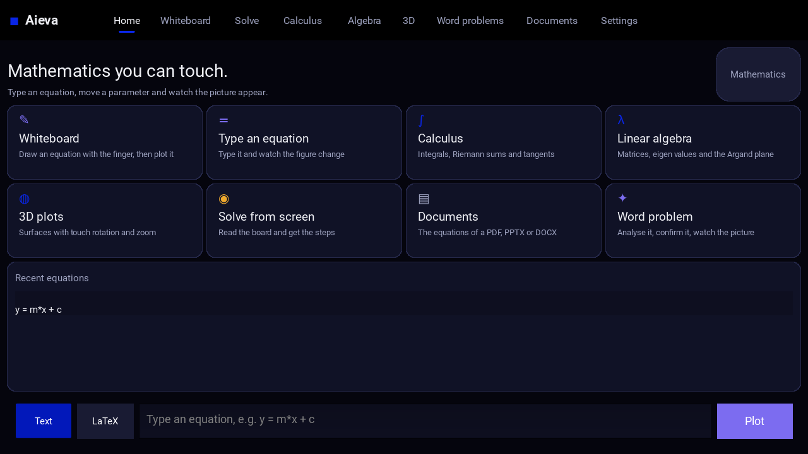
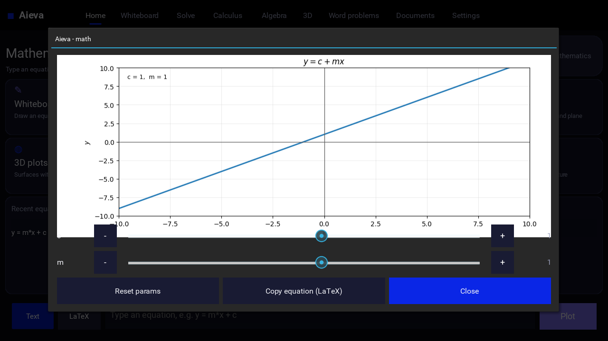
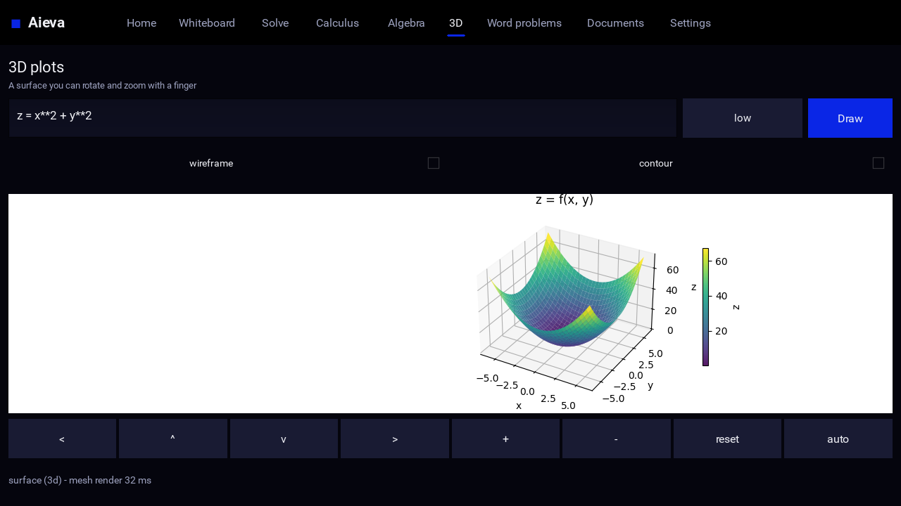

# Aieva (v1)

**Aieva** is a screen-aware AI educational visualisation assistant for interactive
smart boards and desktop computers.

| | |
|---|---|
| **Core** | SymPy (symbolic maths), NumPy/SciPy (numerics), Matplotlib (rendering) |
| **UI** | Kivy — touch first, smart-board sized targets |
| **Cloud** | FastAPI fog server in front of Google Gemini (OCR + explanations) |
| **Offline** | Everything works with mocks — a Gemini key is optional |



---

## Contents

- [Features](#features)
- [Architecture](#architecture)
- [Quick start](#quick-start)
- [Configuration](#configuration)
- [Tests](#tests)
- [Project layout](#project-layout)
- [Documentation](#documentation)
- [Android smart boards](#android-smart-boards)
- [License](#license)

---

## Features

| ID | Feature | What you get |
|---|---|---|
| 1.a | Equation plotting | Type `y = mx + c`; the figure opens with a slider per parameter |
| 1.b | Calculus | Integrals with the shaded area, four Riemann methods, tangent animation |
| 1.c | Linear algebra | Vectors, matrix transforms with a warped grid, eigen values, systems, Argand |
| 1.d | 2D and 3D plots | Surfaces with touch rotation, zoom and quality tiers |
| 1.e | Solve from screen | Select a region of the board → OCR → SymPy → step by step |
| 1.f | Word problems | Four template categories with a confirmation card and an animation |
| — | Documents | The equations of a PDF, PPTX or DOCX, ready to plot or solve |
| — | Settings | Server URL, render quality, offline mode, pen thickness, palm rejection |





---

## Architecture

A **plugin modular monolith** in three layers. The core never imports Kivy, so
every piece of maths is testable headless; the UI only *calls* the core.

```
┌───────────────────────────  aieva/ui  (Kivy)  ────────────────────────────┐
│  screens/  home · whiteboard · solver · wordproblem · documents · settings │
│  widgets/  plot modal · sliders · steps panel · whiteboard · toast        │
└───────────────────────────────┬───────────────────────────────────────────┘
                                │  calls (never re-implements)
┌───────────────────────────────▼───────────────────────────────────────────┐
│  aieva/plugins/  math  →  equations · calculus · linalg · complexnum    │
│                        plot3d · solver · wordproblems · templates         │
├───────────────────────────────────────────────────────────────────────────┤
│  aieva/core/  safe_parse · latex_adapter · models · cache · history       │
│                ocr/ (preprocess · engines · pipeline · worker)            │
│                llm/ (prompts · client)   docs_parser/ (pdf · pptx · docx) │
└───────────────────────────────┬───────────────────────────────────────────┘
                                │  HTTP (fog)
┌───────────────────────────────▼───────────────────────────────────────────┐
│  server/  FastAPI  →  /health · /api/math/ocr · /explain · /wordproblem   │
└───────────────────────────────────────────────────────────────────────────┘
```

**Rules the code follows**

- no `eval` / `exec` on user or LLM text — the parser has an allow-list;
- every LLM answer is verified with SymPy before it reaches the screen;
- OCR, LLM and symbolic work run in worker threads, never on the UI thread;
- the core and the plugins import no Kivy.

A new subject (Biology, Chemistry, Physics) is a new directory in
`aieva/plugins/` — the home screen, the history and the registry pick it up
without a change in the core. See
[`docs/ADDING_A_SUBJECT.md`](docs/ADDING_A_SUBJECT.md) and the template in
`aieva/plugins/_template_plugin/`.

---

## Quick start

**Requirements:** Python 3.11+, and the system libraries Kivy needs
(`libmtdev1`, `libgl1-mesa-dri`, `libegl1` on Debian / Ubuntu).

```bash
git clone <your-repo> aieva && cd aieva
python3.11 -m venv .venv && source .venv/bin/activate   # Windows: .venv\Scripts\activate
pip install -r requirements.txt -r requirements-server.txt -r requirements-dev.txt
```

**Run the fog server** (the only process that talks to Google):

```bash
./scripts/run_server.sh          # http://127.0.0.1:8000
```

Without a Gemini key the server runs in **mock mode** and answers with
deterministic canned data — the whole application is usable that way.

**Run the application:**

```bash
./scripts/run_app.sh             # or: python -m aieva.ui.app
```

**On Windows (PowerShell)** use the scripts of the same name:

```powershell
.\scripts\run_server.ps1      # the fog server
.\scripts\run_app.ps1         # the application
```

**Run the background OCR service** (optional — it watches a folder and writes
the recognised LaTeX into an outbox):

```bash
./scripts/run_ocr_worker.sh
```

On Windows:

```powershell
python -m aieva.core.ocr.worker --inbox ocr_inbox --outbox ocr_outbox --mock --once
```

On a machine without a display, wrap the app in `xvfb-run -a python -m aieva.ui.app`.

---

## Configuration

```bash
cp .env.example .env              # then fill in GEMINI_API_KEY if you have one
```

| Variable | Default | Meaning |
|---|---|---|
| `GEMINI_API_KEY` | *(empty)* | Key from <https://aistudio.google.com>; optional in mock mode |
| `GEMINI_MODEL` | `gemini-3.8-flash` | The model the server uses |
| `OPENAI_API_KEY` | *(empty)* | Optional fallback LLM |
| `WOLFRAM_APP_ID` | *(empty)* | Optional answer verification |
| `AIEVA_SERVER_URL` | `http://127.0.0.1:8000` | Where the app looks for the fog server |
| `AIEVA_SERVER_KEY` | *(empty)* | Shared secret, sent as `X-Aieva-Key` |
| `AIEVA_SERVER_TIMEOUT` | `30` | Seconds before a cloud call is given up |
| `AIEVA_MOCK_LLM` | `false` | The server answers with canned data (no key needed) |
| `AIEVA_OFFLINE_MODE` | `false` | `true` stops every cloud call; the app falls back locally |
| `AIEVA_CACHE_DIR` | `.aieva_cache` | The on-disk cache (OCR, plots, explanations, settings) |
| `AIEVA_QUALITY` | `low` | The render quality: `low` / `normal` / `high` |

The settings a **teacher** changes while the application runs (the server URL,
the quality, the pen thickness, the palm rejection) live in the *Settings*
screen and are stored in `<cache>/user_settings.json`.

---

## Tests

```bash
pytest                        # unit + integration
ruff check .                  # lint
black --check .               # formatting
./scripts/run_tests.sh        # the same, with Xvfb when needed
```

The suite covers the core, the plugins, the server and the headless UI:
**532 tests**, 2 skipped (they need a live Gemini key). The coverage of
`aieva/core` and `aieva/plugins` is **83 %** (the target of the plan was 75 %).
The same run happens on every push — see
[`.github/workflows/ci.yml`](.github/workflows/ci.yml).

---

## Project layout

```
aieva/
├── aieva/
│   ├── config.py              # the settings loader (.env + defaults)
│   ├── core/                  # Kivy-free: parsing, maths, cache, OCR, documents
│   ├── plugins/
│   │   ├── math/              # the subject of v1 (1.a - 1.f)
│   │   └── _template_plugin/  # the documented stub for the next subject
│   └── ui/                    # the Kivy application
├── server/                    # the FastAPI fog server
├── tests/                     # unit, integration and live tests + fixtures
├── scripts/                   # run_server / run_app / run_ocr_worker / run_tests
├── docs/                      # the plan, the API contract, the demo script
├── Dockerfile
└── pyproject.toml             # ruff, black and pytest configuration
```

---

## Documentation

| Document | Content |
|---|---|
| [`docs/PROGRESS.md`](docs/PROGRESS.md) | The phase log — what was built, what is left, what is blocked |
| [`docs/DEMO_SCRIPT.md`](docs/DEMO_SCRIPT.md) | The eight demos (A – H) with the exact steps |
| [`docs/API_CONTRACT.md`](docs/API_CONTRACT.md) | The endpoints of the fog server |
| [`docs/ADDING_A_SUBJECT.md`](docs/ADDING_A_SUBJECT.md) | How to add Biology, Chemistry or Physics |
| [`docs/ANDROID_READINESS.md`](docs/ANDROID_READINESS.md) | What is ready for a board, what is missing |
| [`docs/DECISIONS.md`](docs/DECISIONS.md) | The architecture decision records (ADR) |
| [`docs/MANUAL_STEPS_NEEDED.md`](docs/MANUAL_STEPS_NEEDED.md) | The steps that need a human (the API key, a board) |

---

## Android smart boards

**No APK is built in this cycle** (see
[ADR-001](docs/DECISIONS.md)). The desktop build is the supported target and
the code stays Android-compatible:

- the UI is Kivy, so the same code runs on a board;
- the core has no hard dependency on SciPy or OpenCV (internal fallbacks
  replace both), which keeps the dependency set small;
- the heavy work (OCR, LLM) runs on the fog server, so no on-device ML runtime
  is needed;
- the board work — DPI scaling, 56 dp touch targets, palm rejection, the
  quality tiers and the settings screen — is implemented.

The packaging recipe and the checklist are in
[`docs/ANDROID_READINESS.md`](docs/ANDROID_READINESS.md).

---

## License

MIT — see [LICENSE](LICENSE).
